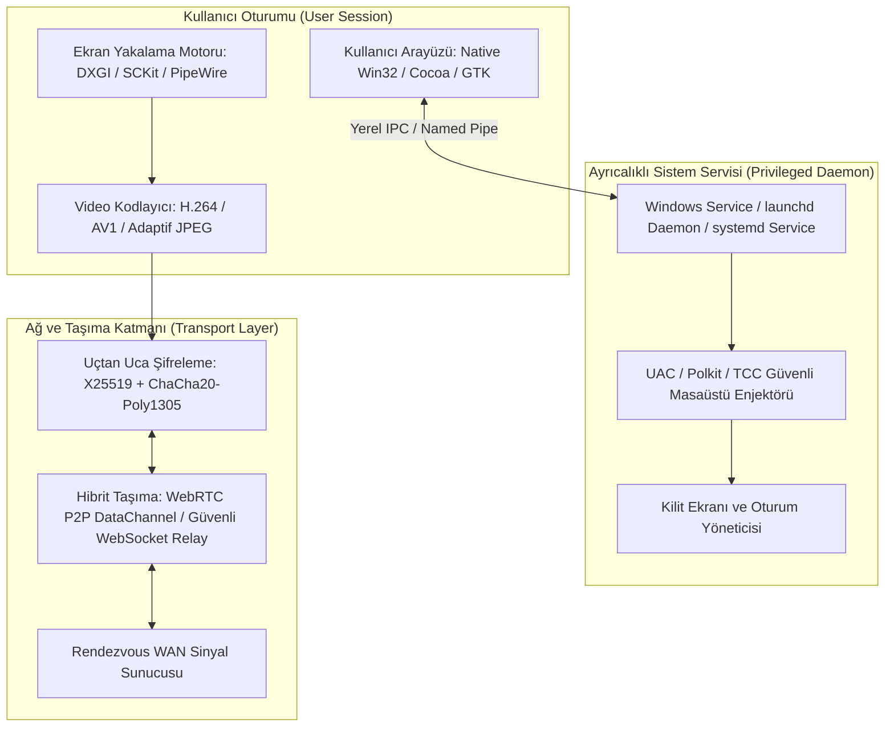

# 🌐 Kurumsal Uzak Masaüstü Mimarisi Kapsamlı Analiz ve OxiDesk Entegrasyon Planı

**Tarih:** 2026-10-21  
**Hedef Kapsam:** Windows, macOS, Linux ve Web Platformları  
**Referans Yaklaşım:** Endüstriyel Standartlar, Sıfır Güven (Zero-Trust) Güvenlik Modeli, Düşük Gecikmeli Medya Boru Hatları  
**Uygulama:** OxiDesk v3.0.0 (Rust Tabanlı Çapraz Platform Uzak Masaüstü Ekosistemi)

---

## 📑 İçindekiler
1. [Yönetici Özeti ve Temel Mimari Prensipleri](#1-yönetici-özeti-ve-temel-mimari-prensipleri)
2. [Güvenlik ve İzolasyon Mimarisi](#2-güvenlik-ve-izolasyon-mimarisi)
3. [Ekran Yakalama ve Video Akış Boru Hattı](#3-ekran-yakalama-ve-video-akış-boru-hattı)
4. [Girdi Enjeksiyonu ve Çevre Birimi Kontrolü](#4-girdi-enjeksiyonu-ve-çevre-birimi-kontrolü)
5. [Veri Transferi ve Gelişmiş Özellikler](#5-veri-transferi-ve-gelişmiş-özellikler)
6. [Ağ Geçişi ve WAN Sinyalleşme Mimarisi](#6-ağ-geçişi-ve-wan-sinyalleşme-mimarisi)
7. [OxiDesk İçin Adım Adım Uygulama Planı (Implementation Plan)](#7-oxidesk-için-adım-adım-uygulama-planı)
8. [Doğrulama ve Test Stratejisi](#8-doğrulama-ve-test-stratejisi)

---

## 1. Yönetici Özeti ve Temel Mimari Prensipleri

Modern kurumsal uzak masaüstü yazılımları, **üç bağımsız katmandan** oluşan bir ayrışım modeli (separation of concerns) ile inşa edilir:



### Temel Tasarım Kuralları
1. **Sıfır Güven (Zero-Trust):** Hiçbir bağlantı doğrudan güvenli kabul edilmez; her oturum tek kullanımlık dinamik anahtarlar (OTP) ve oturum bazlı simetrik şifreleme ile izole edilir.
2. **Kullanıcı Alanı (User Space) ve Ayrıcalıklı Alan (Privileged Space) Ayrımı:** Normal ekran yakalama ve GUI kullanıcı oturumunda çalışırken, kilit ekranı (`Winlogon`), UAC ve sistem izinleri ayrıcalıklı servis üzerinden yönetilir.
3. **Sıfır Kopyalama (Zero-Copy) Medya Yolu:** Ekran yakalama GPU VRAM'inde gerçekleşir, doğrudan donanım kodlayıcıya (NVENC, QuickSync, AMF, VideoToolbox, VA-API) aktarılır ve CPU yükü minimize edilir.

---

## 2. Güvenlik ve İzolasyon Mimarisi

Uzaktan yönetim yazılımlarında en kritik zafiyet noktası yetkisiz erişim, oturumun ele geçirilmesi ve işletim sistemi güvenlik pencerelerinin (UAC, Kilit Ekranı) aşılamamasıdır.

### 2.1. Kriptografik El Sıkışma ve Oturum Şifrelemesi
* **Anahtar Değişimi:** Ephemeral X25519 (ECDH) ile oturum başına dinamik Diffie-Hellman el sıkışması.
* **Simetrik Şifreleme:** ChaCha20-Poly1305 (veya AES-256-GCM donanım AES-NI desteği ile).
* **Parola Türetme (KDF):** Kullanıcı PIN kodundan `Argon2id` veya `PBKDF2-HMAC-SHA256` ile oturum doğrulama token'ı türetme; sunucuda veya bellekte asla düz metin PIN tutulmaz.
* **Man-in-the-Middle (MitM) Koruması:** Her istemcinin kalıcı Ed25519 anahtar çifti parmak izi (Fingerprint) oluşturulur; ilk bağlantıda TOFU (Trust On First Use) ve parmak izi karşılaştırma ekranı sunulur.

### 2.2. Güvenli Masaüstü (Secure Desktop) ve UAC Yönetimi
| İşletim Sistemi | Güvenlik Duvarı / Kilit Mekanizması | Aşma / Entegrasyon Yöntemi |
| :--- | :--- | :--- |
| **Windows** | `Consent.exe` (UAC), `Winlogon` (Ctrl+Alt+Del), ScreenSaver | `NT AUTHORITY\SYSTEM` olarak çalışan Windows Hizmeti (`oxidesk_service`), `WTSQueryUserToken` ve `CreateProcessAsUserW` ile girdi enjeksiyonunu masaüstü değiştirerek (`OpenInputDesktop`) güvenli masaüstüne aktarır. |
| **macOS** | TCC (Transparency, Consent, and Control), FileVault | `launchd` root daemon'ı, kullanıcı oturumundaki helper sürece IPC ile bağlanır; TCC ekran kaydı ve Accessibility izinleri kullanıcı onayına sunulur. |
| **Linux** | Polkit (PolicyKit), Wayland Kilit Ekranı (`ext-session-lock-v1`) | `systemd --system` servisi, D-Bus üzerinden yetkilendirme isteklerini arayüze iletir; root yetkisiyle sanal girdiyi `uinput` kernel modülüne basar. |

### 2.3. Dinamik Güvenlik Özellikleri
- **Tek Kullanımlık PIN (OTP):** Bağlantı kapandığı anda PIN'in otomatik yenilenmesi (Zero-Trust Re-generation).
- **Brute-Force Koruması:** 3 hatalı PIN denemesinde 30 saniye gecikme, 5 denemede IP adresi bazlı geçici blokaj.
- **Gizlilik Modu (Black Screen / Curtain Mode):** Uzak kullanıcının ekranını fiziksel olarak karartarak ofis ortamında hassas verilerin yerel ekrandan görünmesini engelleme.
- **Girdi Kilitleme (Block Remote/Local Input):** İstemcinin veya hedefin yerel klavye/fare hareketlerini geçici olarak kilitleme (`BlockInput` API).
- **Denetim İzi (Audit Log):** Bağlantı zamanı, bağlanan cihaz ID'si, IP adresi, transfer edilen dosyalar ve oturum sonlanma nedenini SHA-256 imzalı değişmez log dosyasında saklama.

---

## 3. Ekran Yakalama ve Video Akış Boru Hattı

Gecikmenin (latency) 30ms'nin altında tutulması için platformlara özel düşük seviyeli yakalama API'leri kullanılır.

### 3.1. Platform Bazlı Yakalama Motorları

```mermaid
graph LR
    subgraph "Windows Pipeline"
        DXGI[DXGI Desktop Duplication API] --> D3D11[D3D11 Texture (GPU VRAM)]
        D3D11 --> NVENC[NVENC / AMF / QSV Hardware Encode]
        GDI_FALLBACK[GDI In-Memory Fallback] --> JPEG_DIFF[Adaptif JPEG Tile Encoder]
    end

    subgraph "macOS Pipeline"
        SCKit[ScreenCaptureKit / SCStream] --> Metal[Metal Texture (Zero-Copy)]
        Metal --> VToolbox[VideoToolbox H.264/HEVC Encoder]
    end

    subgraph "Linux Pipeline"
        PipeWire[PipeWire Screen Cast Portal] --> DMABUF[DMA-BUF GPU Buffer]
        DMABUF --> VAAPI[VA-API / FFmpeg Hardware Encoder]
        X11[X11 XShmGetImage] --> X11_ENC[Software Fallback Encoder]
    end
```

1. **Windows:**
   - **Modern (Önerilen):** DXGI Desktop Duplication (`IDXGIOutputDuplication`) ile doğrudan GPU VRAM'inden masaüstü karesi alma. GPU'da dirty-rect analizi.
   - **Win11/Modern UWP:** Windows Graphics Capture (WGC) API (`Direct3D11CaptureFramePool`).
   - **Fallback:** Win32 GDI `BitBlt` (Sanal makineler ve RDP oturumları için).
2. **macOS:**
   - **Modern (macOS 12.3+):** `ScreenCaptureKit` (`SCStream`). GPU Metal dokuları üzerinden sıfır kopyalama ve pencere bazlı filtreleme.
   - **Legacy:** `CGDisplayStream` veya `CoreGraphics Quartz Display Services`.
3. **Linux:**
   - **Wayland (Modern standart):** `xdg-desktop-portal` + `PipeWire` DMA-BUF paylaşımı.
   - **X11:** `XShmGetImage` (X Shared Memory Extension) + `XFixes` (fare imleci yakalama).

### 3.2. Video Kodlama ve Akış Stratejisi
* **Yüksek Bant Genişliği & Güçlü Donanım:** Donanım hızlandırmalı H.264 / H.265 (HEVC) / AV1 (NVENC, QuickSync, VideoToolbox).
* **Düşük Kaynak & Taşınabilir İstemci (QuickSupport):** Adaptif JPEG / WebP Tile-based akış. Yalnızca değişen pikseller (Dirty Rectangles) 64x64 bloklar halinde gönderilerek işlemci tüketimi %2'nin altına indirilir.
* **Dinamik FPS & Bitrate Kontrolü:** Ağ tıkanıklığı (RTT gecikmesi) 80ms'yi aştığında kare hızı otomatik olarak 60 FPS -> 30 FPS -> 15 FPS seviyesine düşürülür.

---

## 4. Girdi Enjeksiyonu ve Çevre Birimi Kontrolü

Uzak yöneticinin klavye ve fare hareketlerinin hedef işletim sisteminde gecikmesiz ve doğru koordinatlarla yeniden üretilmesidir.

### 4.1. Platform Bazlı Girdi Yöntemleri
1. **Windows:**
   - `SendInput` (`user32.dll`): Fare için mutlak koordinatlar (`0..65535` aralığına normalize edilmiş `MOUSEEVENTF_ABSOLUTE | MOUSEEVENTF_MOVE`).
   - Klavye için `KEYEVENTF_SCANCODE` kullanımı: Farklı dil klavyelerinde (TR-Q, US, DE vb.) karakterlerin doğru basılması için sanal tuş kodu yerine donanım tarama kodu (Scan Code) kullanılır.
   - Unicode karakter girişi: `KEYEVENTF_UNICODE` ile UTF-16 karakterlerin doğrudan iletimi.
2. **macOS:**
   - `CGEventCreateMouseEvent` ve `CGEventCreateKeyboardEvent`.
   - `CGEventPost(kCGHIDEventTap, event)` ile sistem olay kuyruğuna enjeksiyon.
   - Tuş dönüşüm matrisi: Windows `Ctrl` tuşunu macOS `Command (⌘)` veya `Control` tuşuna yapılandırılabilir eşleme.
3. **Linux:**
   - **Wayland:** `libei` (Emulated Input Protocol) veya `/dev/uinput` üzerinden sanal HID aygıtı oluşturma.
   - **X11:** `XTestFakeKeyEvent` ve `XTestFakeMotionEvent` (`libXtst`).

### 4.2. Güvenli Girdi Serbest Bırakma (`ReleaseAllKeys`)
Bağlantı aniden kesildiğinde veya pencere odağı kaybolduğunda, basılı kalan `Ctrl`, `Alt`, `Shift` veya fare butonlarının işletim sisteminde takılı kalmasını (sticky key lockup) önlemek için anında `ReleaseAll` temizlik rutini tetiklenir.

---

## 5. Veri Transferi ve Gelişmiş Özellikler

| Özellik | Teknik Mimari | Protokol / Yaklaşım |
| :--- | :--- | :--- |
| **Pano Senkronizasyonu (Clipboard)** | Çift yönlü metin (UTF-8), Zengin Metin (HTML/RTF), Bitmap (PNG/DIB) ve Dosya Kopyalama (`CF_HDROP`). | Pano içeriği değiştiğinde (`WM_CLIPBOARDUPDATE`), hash kontrolü yapılır; yalnızca yeni içerik diğer tarafa iletilir. |
| **Parçalı Dosya Transferi (File Transfer)** | 64 KB – 256 KB boyutunda chunk'lara bölünmüş binary akış. Durdurma/devam etme (Pause/Resume). | SHA-256 parça doğrulama, `Range` tabanlı yeniden başlatma ve dosya dizini gezgini (File Explorer API). |
| **Ses Aktarımı (Audio Streaming)** | Windows WASAPI Loopback, macOS CoreAudio TAP, Linux PulseAudio monitor. | Yakalanan stereo 48 kHz PCM ses, **Opus** codec'i ile 32 kbps akışa sıkıştırılarak WebSocket/WebRTC ses kanalından gönderilir. |
| **Sanal Terminal / Shell** | Grafik arayüzden bağımsız arka plan komut satırı (PowerShell / Bash). | PTY (Pseudo-terminal - Windows `CreatePseudoConsole`, Unix `openpty`) üzerinden bağımsız WebSocket kanalı. |
| **Çoklu Monitör Yönetimi** | Tüm monitörlerin sanal masaüstü (`VirtualScreen`) olarak birleştirilmesi veya bağımsız monitör seçimi. | Ekran çözünürlüğü ve DPI bilgisi el sıkışmada bildirilir; istemci tek tıkla monitör 1 / monitör 2 arasında geçiş yapar. |

---

## 6. Ağ Geçişi ve WAN Sinyalleşme Mimarisi

İstemcilerin %90'ı kurumsal NAT veya CGNAT (Carrier-Grade NAT) arkasında yer alır.

```mermaid
sequenceDiagram
    autonumber
    actor Admin as IT Yöneticisi (OxiDesk)
    participant Relay as Rendezvous WAN Sunucusu
    actor Client as Uzak Personel (OxiQuickSupport)

    Admin->>Relay: WS Register: Admin ID (Ed25519 İmza)
    Client->>Relay: WS Register: Client ID (9 Haneli OxiDesk ID) + SOS Beacon
    Admin->>Relay: Connect Request (Hedef: Client ID)
    Relay->>Client: Gelen Bağlantı Talebi (Admin ID)
    Client->>Relay: Kabul Edildi + Ephemeral X25519 Public Key
    Relay-->>Admin: P2P Hole Punch Adayları (STUN IP:PORT)
    Relay-->>Client: P2P Hole Punch Adayları (STUN IP:PORT)
    
    alt P2P Bağlantı Başarılı (UDP Hole Punching)
        Admin<<-->>Client: Doğrudan E2EE P2P Veri Akışı (Sıfır Sunucu Yükü)
    else Simetrik NAT / Blokeli UDP
        Admin<-->>Relay: Şifreli Veri Akışı (E2EE Relay)
        Relay<-->>Client: Şifreli Veri Akışı (Sunucu İçeriği Göremez)
    end
```

1. **Rendezvous Sunucusu:** Sadece kimlik doğrulama, cihaz tescili ve sinyalleşmeyi yürütür; içeriği çözemez (Zero-Knowledge Relay).
2. **STUN / UDP Hole Punching:** İki tarafın dış IP:PORT ikilisini tespit edip doğrudan P2P köprü kurmasını sağlar.
3. **Turn/Relay Fallback:** P2P başarısız olursa trafik şifreli paketler halinde sinyal sunucusu üzerinden yönlendirilir.

---

## 7. OxiDesk İçin Adım Adım Uygulama Planı

OxiDesk'in mevcut Rust çekirdeğine bu mimariyi entegre etmek için oluşturulan yol haritası:

### Faz 1: Güvenlik ve Sıfır Güven (Zero-Trust) Güçlendirmesi
- [ ] **Kriptografik El Sıkışma:** `x25519-dalek` ve `chacha20poly1305` kütüphanelerini ekleyerek oturum başında dinamik anahtar türetimini devreye alma.
- [ ] **Girdi Güvenliği:** `releaseAllKeys` mekanizmasını bağlantı kopma anına ve pencere `WM_KILLFOCUS` olayına bağlama.
- [ ] **Oturum İzolasyonu:** Windows Hizmeti (`oxidesk_service`) ile `OpenInputDesktop` üzerinden UAC ve Kilit Ekranı geçişini sorunsuz hale getirme.

### Faz 2: Ekran Yakalama ve Performans Optimizasyonu
- [ ] **DXGI Desktop Duplication Entegrasyonu:** Windows için DirectX 11 GPU yakalama motorunu `src/capture.rs` içine ekleme; sanal makineler için GDI fallback'i koruma.
- [ ] **Donanım Hızlandırmalı Akış:** Adaptif JPEG motoruna ek olarak yerel H.264/WebP döşemeli (tiled) sıkıştırma desteği.
- [ ] **Çoklu Monitör Seçicisi:** Yerel Win32 izleyici penceresine (Native Viewer) "Monitör 1 / Monitör 2 / Tümü" butonları ekleme.

### Faz 3: İleri Seviye Çevre Birimleri ve Veri Transferi
- [ ] **Çift Yönlü Dosya Gezgini (Remote File Explorer):** Yönetici konsolundan hedef cihazın disklerini listeleyip sürükle-bırak ile dosya aktarabilme.
- [ ] **Düşük Gecikmeli Ses (WASAPI Loopback):** `src/audio.rs` üzerinden yakalanan PCM ses verisini `opus` ile paketleyip WebSocket ses kanalına iletme.
- [ ] **Uzaktan Komut Satırı (Remote PowerShell PTY):** Grafik ekrandan bağımsız arka plan sistem onarım terminali açma.

### Faz 4: Çapraz Platform Genişleme (macOS & Linux)
- [ ] **Linux Desteği:** `PipeWire` ve `uinput` kullanarak Linux için `oxidesk` ve `oxidesk_qs` derleme hedefleri oluşturma.
- [ ] **macOS Desteği:** `ScreenCaptureKit` ve `CoreGraphics` ile macOS taşınabilir hızlı destek istemcisi hazırlama.

---

## 8. Doğrulama ve Test Stratejisi

1. **Güvenlik Doğrulaması:**
   - Kasıtlı olarak yanlış PIN girilerek 3. denemede 30 sn blokajın tetiklendiğini test etme.
   - Oturum kapandığında hedef makinedeki PIN'in anında değiştiğini (OTP) teyit etme.
   - UAC onay penceresi (`Consent.exe`) açıldığında uzaktan tıklanabildiğini doğrulama.
2. **Performans Doğrulaması:**
   - Boşta dururken (statik masaüstü) ağ trafiğinin 0 Kbps'e indiğini ve CPU tüketiminin <%1 olduğunu teyit etme.
   - Video oynatılırken 60 FPS akışta gecikmenin (RTT) <35ms olduğunu ölçümleme.
3. **Girdi Doğrulaması:**
   - Türkçe Q klavyede `ğ, ü, ş, ı, ö, ç, @, #, €` karakterlerinin eksiksiz iletildiğini test etme.
   - Bağlantı sırasında kablo çekildiğinde `Shift` veya `Ctrl` tuşlarının basılı kalmadığını teyit etme.
